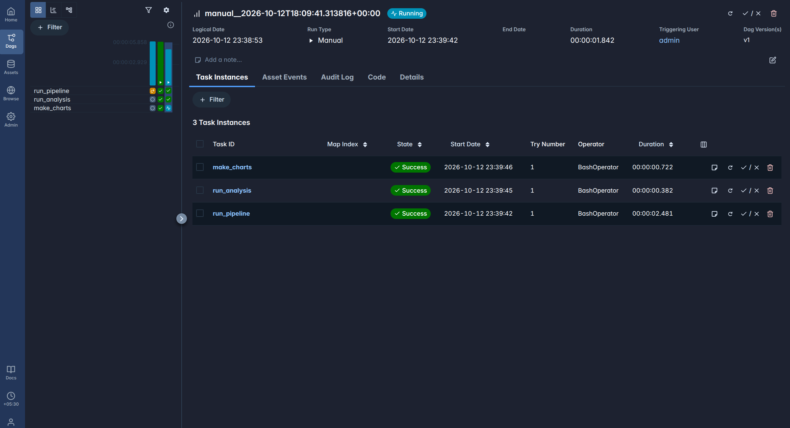
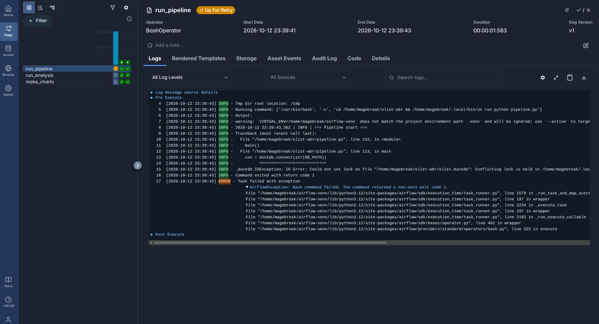

# Olist Weekly Business Review — ELT Pipeline & Analysis

Big Data in Industry — Take-Home Assignment 1.
An ELT pipeline over the Olist Brazilian e-commerce dataset (~100k orders, 2016–2018), with
data-quality alarms, SQL analysis, and a metrics-backed recommendation on customer satisfaction.

**Stack:** Python 3.12 · DuckDB (single-file analytical database, no server) · matplotlib/seaborn

## Architecture

    data/raw/*.csv --> raw_*  --> stg_*   --> DQ checks --> mart_orders --> analysis SQL --> CSVs + charts
                      (as-is,    (typed,     (alarm on     (1 row per
                       all text)  cleaned)    breach)       order)

- **Idempotent:** every table is built with `CREATE OR REPLACE`, so reruns rebuild instead of appending.
- **Failure handling:** each step is logged to the console and `pipeline.log`; a missing file, a missing
  column, a SQL error, a DQ breach, or a fan-out in the mart stops the run with a clear message and exit code 1.
- **DQ gate:** if a check fails, the mart is not rebuilt, so downstream analysis never reads bad data.

## Repository layout

| Path | What it is |
|---|---|
| `pipeline.py` | ELT pipeline: raw load → staging → DQ checks → mart |
| `run_analysis.py` | Runs all analysis SQL, saves results to `report/results/*.csv` |
| `make_charts.py` | Builds the report charts into `report/charts/*.png` |
| `sql/staging/` | Cleaning and typing (one file per staging table) |
| `sql/checks/` | Part B data-quality checks (each returns its failing rows) |
| `sql/marts/` | `mart_orders`: one analysis-ready row per order |
| `sql/analysis/` | Part C queries Q1–Q5 |
| `sql/insights/`, `sql/metrics/` | Part D evidence queries and weekly metrics |

## How to run

**1. Get the data.** Download the dataset from
https://www.kaggle.com/datasets/olistbr/brazilian-ecommerce and unzip all 9 CSVs into `data/raw/`.

**2. Install dependencies.** Either option works.

With [uv](https://docs.astral.sh/uv/) (recommended):
```bash
uv sync
```

Or with plain pip:
```bash
python3.12 -m venv .venv && source .venv/bin/activate
pip install -r requirements.txt
```

**3. Run everything.** If you used pip, drop the `uv run` prefix.
```bash
uv run python pipeline.py       # builds olist.duckdb (~2 s); exit code 0 = success
uv run python run_analysis.py   # Part C/D results -> report/results/
uv run python make_charts.py    # charts -> report/charts/
```

**Explore interactively (optional).** With the [DuckDB CLI](https://duckdb.org/docs/installation/):
`duckdb -readonly olist.duckdb`

## Data-quality checks

| Check | Failing rows | Handling |
|---|---|---|
| dq01 null / duplicate `order_id` | 0 | Zero tolerance |
| dq02 delivered before purchase | 0 | Zero tolerance |
| dq03 payment ≠ items + freight (> R$1) | 249 | Flagged (`flag_payment_mismatch`); mostly installment interest |
| dq04 order with no customer | 0 | Zero tolerance |
| dq05 delivered but no delivery date | 8 | Flagged (`flag_missing_delivery_date`); excluded from delay analysis |
| dq06 more than one review per order (post-dedup) | 0 | Raw had 551 duplicates; staging keeps the latest per order |

Known issues run against a fixed baseline: if a count grows, the alarm fires.

## Key definitions

- **Customer** = `customer_unique_id`. `customer_id` is regenerated for every order.
- **Revenue** = item `price + freight_value`. `payment_value` includes installment interest.
- **Valid order** = any status except `canceled` and `unavailable`.
- **On time** = delivered on or before the promised calendar day.



During testing, two overlapping runs hit DuckDB's single-writer lock (log below).
Fixed with `max_active_runs=1`, so runs queue instead of overlapping.


